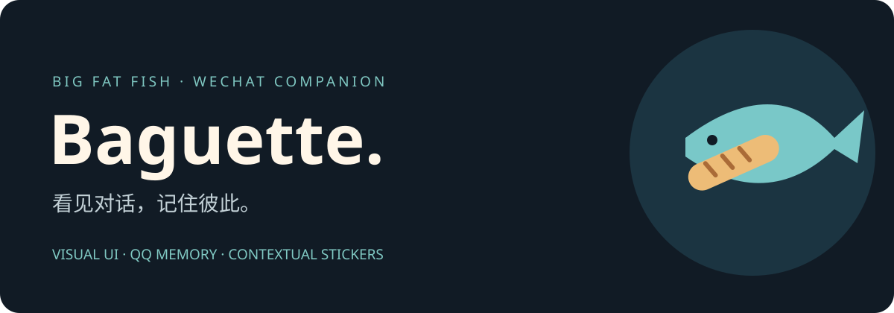

> **Ubuntu 24.04 本地包（开发预览）**：在机房电脑执行 `bash Start.sh`，通过浏览器填写 DeepSeek key、登录自选微信账号并绑定一个聊天。小号不是必要条件。见 [Ubuntu 安装指南](docs/UBUNTU.zh-CN.md)；原 Mac VM 路径仍保留。Linux 收藏表情发送尚未校准。

[下载 Ubuntu 预览包](https://github.com/andyDgreat12345/baguet-ubuntu/releases) · [English](README.en.md) · [验收范围](VALIDATION.json)

<div align="center">


# Baguette 🥖 · 微信大肥鱼

**会接话、记得住，也看得懂表情的微信伙伴。**

纯视觉微信桥 × DeepSeek × 原版 QQ 记忆与表情框架

[English](README.en.md) · [安装指南](docs/INSTALL.zh-CN.md) · [Agent 安装](AGENTS.md) · [架构](docs/ARCHITECTURE.md) · [致谢](docs/ATTRIBUTION.md)


</div>

## 它做什么

Baguette 把普通微信账号接到 AstrBot。Ubuntu 24.04 版本把官方 Linux 微信和独立桌面打包进 Docker；原 macOS VM 路径也保留。它从**可见聊天窗口的截图**读消息和表情，用 DeepSeek 回应，通过真实微信界面输入和点击发送。**不读取微信聊天数据库，不注入微信进程**。

这里的「纯视觉」指聊天内容来自屏幕，而不是微信协议或私有数据库。它不是点对点网络模型，也不是微信官方机器人 API。

- **有性格的回复**：大肥鱼人设，中文、英文、群聊混合语境。
- **沿用 QQ 的记忆**：真实 AstrBot + LivingMemory，分会话召回、总结、明确纠正和群体用语学习。
- **表情语义**：原版 `astrbot_plugin_stealer` 负责视觉分类、情绪和使用场景，本地视觉结果交给 DeepSeek 理解。
- **表情动作（macOS）**：打开收藏，按目录定位，下滚到剩余行，核对缩略图后点一次。Linux 收藏发送待校准。
- **群聊参与**：读群；被提及、被定向及短时连续交流时回应。主号私聊和群聊记忆隔离。
- **可核对的发送**：空草稿、账号和目标验证；发送后检查自己的气泡。结果不明确时暂停，避免重复发送。

## 开始使用

Ubuntu 24.04 上安装 Docker Engine + Compose v2 后，在完整包根目录运行：

```bash
bash Start.sh
```

浏览器填写 DeepSeek key → 准备模型 → 扫码登录自选账号 → 核对绑定一个聊天 → 开始。详细步骤、机房远程管理与数据卷说明见 [Ubuntu 中文指南](docs/UBUNTU.zh-CN.md)。建议以 **16 GB 内存 / 40 GB 空闲磁盘**作为试用预算；这不是测得的最低要求。DeepSeek API 可能计费，首次需下载依赖和本地模型。

已有 Apple Silicon Mac 用户可使用 [macOS VM 安装指南](docs/INSTALL.zh-CN.md)。**Linux 是开发预览：已验证构建、设置面板和微信登录界面；真实账号端到端收发仍待验收。** 可复核的范围见 [VALIDATION.json](VALIDATION.json)。

## 实现状态

| 能力 | 当前边界 |
|---|---|
| 可见文字读取与自动回复 | 既有 Mac 专用 VM 有实测；新 Linux 适配器尚待登录后的端到端验收 |
| 记忆与学习 | 原版 LivingMemory；分会话，归纳可能出错，应允许用户纠正 |
| 图片/表情理解 | 可见截图裁切；动图仅当前帧；视觉模型可能误读 |
| 收藏表情发送 | 专用环境的 36 张逆序收藏已校准；公开版需导入自己的素材和语义 |
| 改群名 | 用户确认过的群头像绑定可保持会话；头像变化需重新核实 |
| 自动恢复 | 可选保存运行/暂停意图 + 当前登录会话内的进程监督；未完成跨主机重启验收 |
| 所有群、完整历史、语音/视频 | 尚未完整支持；不能承诺读取每一条或每个动画帧 |
| 全新机器安装 | 提供脚本/分步指南；未在第二台空白 Mac 上完成全流程验收 |

## 为什么沿用 QQ 框架

本项目的桥接代码负责微信 UI。记忆、检索、反思与表情分类来自已有开源项目，没有把这些上游工作包装成自己的原创算法：

| 项目 | 本项目使用的部分 |
|---|---|
| [AstrBot](https://github.com/AstrBotDevs/AstrBot) | 原生消息流水线、模型调用、工具与会话 |
| [LivingMemory](https://github.com/lxfight-s-Astrbot-Plugins/astrbot_plugin_livingmemory) | 长期记忆、召回、总结和学习 |
| [Stealer](https://github.com/nagatoquin33/astrbot_plugin_stealer) | 表情视觉分类与本地索引 |
| [大肥鱼](https://github.com/whyever77/dafeiyu-astrbot) | 原版人设与行为参考；不声称移植了所有 QQ 工具 |

版本、固定提交和许可证见 [归属说明](docs/ATTRIBUTION.md) 与 [UPSTREAMS.lock.json](UPSTREAMS.lock.json)。

## 参与项目

欢迎提交可复现的 UI 兼容问题、脱敏测试样例、文档翻译和安装验证结果。先看 [贡献指南](CONTRIBUTING.md)。截图请遮住昵称、头像和聊天内容。喜欢这个方向，可以给仓库一个 ⭐，也欢迎把失败案例带回来一起修。

[隐私与限制](docs/PRIVACY.md) · [排错](docs/TROUBLESHOOTING.md) · [路线图](docs/ROADMAP.md) · [安全报告](SECURITY.md)

本项目与腾讯/微信没有官方关联。代码以 AGPL-3.0 发布；上游和模型、虚拟机、第三方素材分别遵循各自许可。请仅在自己有权使用的账号、素材和聊天中部署。
